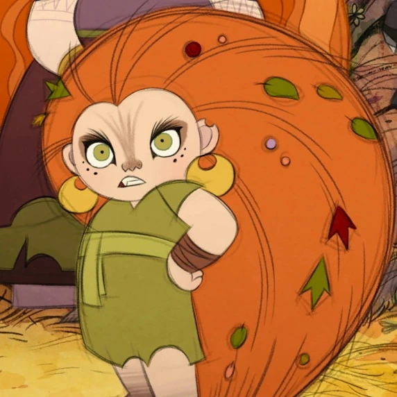
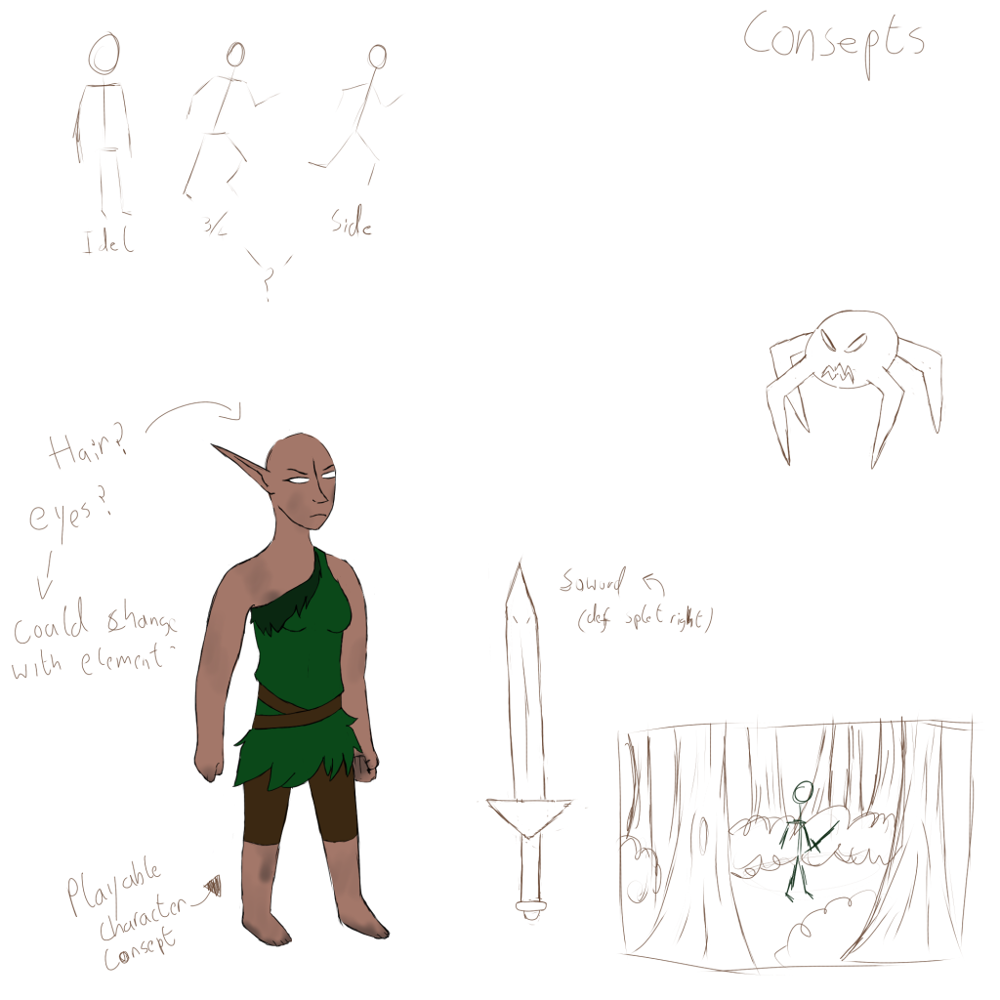

# 25/09/2026 - Tomas
## MarkText / Markdown Better Text Editor ?

In the group had small discussion about word vs markdown, and we kind agreed to try with markdown due to portability and ease of maintain. It is particularly useful for documentation, notes and works very well with git.

Few aspects such including code snippets with easy copy paste functionality from document to testing purpose, additional is using screenshots specially multiple images that word sometimes struggle to open which markdown creates reference to image and does faster then instead word embedding inside document, also markdown can be easy exported into other formats.

Visual studio code can easily edit markdown files jus need additional extension 'Markdown All in One' to edit and preview.

For local editing markdown files can be used open source app [MarkText](https://github.com/marktext/marktext)

Document to help starting with basic syntax: [Markdown Cheat Sheet](Documents/MarkText_Markdown_Cheat_Sheet.pdf)

# 29/09/2026 ChloeW

since our last meeting I came up with a concept for the playable character and came up with a simple sword, her clothes where inspired by the main character Mebh from the movie WolfWalkers. I did a simple design for the reason of the animation for the characters movement

# 29/09/2026 - Tomas
## Primary Display Resolutions Used In Steam Environment

Primary my objective was to find most popular resolution used in pc games, and the best picture are presented inside Steam Environment, because has huge user base and also does Hardware Surveys frequently. Steam Hardware Survey 2026 clearly showed which resolution are mostly used.

||
|:--:|
|*Steam Hardware Survey*|

So far most popular are 1920 x 1080 and fallowing by 2560 x 1440. That means both those screen resolutions are majority and combine them takes more than 70% of all gaming devices. As speaking about aspect ratio most popular are 16:9 and recently increasing 21:9 as more introduced into market Ultra wide monitors or devices.

View more recent data: [Steam Hardware Survey](https://store.steampowered.com/hwsurvey/Steam-Hardware-Software-Survey-Welcome-to-Steam)

# 29th/09/2026 - Nicholas (K00324330)
## Sounds Effects that Used In game Environment and Game Play
my task was to research what sounds effects and audio can be used through the game Project.
i looked at different websites that offer game audio and compared the quality, variety and accessibility of the sounds available.
 
One resource I found was Envato Elements, which contains a large collection of game-related sound effects including UI sounds, footsteps, combat effects, ambient sounds and background music. Having a dedicated library of sounds could help improve the overall player experience and make the game feel more immersive.
 
## Envato Elements Game Sounds
https://elements.envato.com/sound-effects/game-sounds
 
Some useful categories I found:
- User Interface sounds
- Character movement and footsteps
- Combat and weapon effects
- Ambient environment sounds
- Background music
- Achievement and reward sounds 

### Pixabay Sound Effects
https://pixabay.com/sound-effects/search/gaming/
 
Pixabay contains a large collection of free sound effects including:
- Menu and button sounds
- Character movement effects
- Game notifications and rewards
- Arcade and retro game sounds
- Background ambience and music loops
 
One benefit of Pixabay is that sounds can be previewed and downloaded quickly, making it useful when testing guys aswell.

### Mixkit Game Sound Effects
https://mixkit.co/free-sound-effects/game/
 
Mixkit provides a range of free game sound effects that can be used in different gameplay situations. Some categories available include:
- Interface and menu sounds
- Action and combat effects
- Character movement sounds
- Retro game effects
- Environmental audio

# 2nd/10/2026 - Nicholas (K00324330)
## Game Notes Level Desgin Research findings
- level length should be designed around the players speed and level desgin.
### these is what i found out for better levels ond longer gameplay when researching
- Tutorial level: 20-30 sec
- Normal levels : 45-75 sec
- Long levels: 60:100 sec
- whole Game between 100-300  thats include every thing combat, enemies,jump, and what every

- different textures size may require configurable collisions depends on the assets and movements of assets.
- if we want longer level and bigger assets we need res 1280X720 or 1920X1080p which we have i think need to check on that again.

# 03/10/2026 - Tomas
## Assets, licenses and  Free does not automatically mean free tu use

Ill start from licensing because its important understand before ground work started, that free its not always free, ill brake it down some differences, but always need to double check individually the license it self before proceeding.

| License | Use for Commercial game | Require attribution | Can be modified | Issues |
| :------ | :------: | :------: | :------: | :------ |
| CCO | Yes | Not Required | Yes | Mostly None |
| MIT | Yes | Usually Required | Yes | Mostly None |
| CC BY | Yes | Required | Yes | Need Attention |
| GPL | Mostly Yes | Required With Conditions | Yes | Need clear understanding before use |
| Free for Personal use | No | Sometimes | Usually Not | To complicated to use |
| Free for non-commercial | No | Sometimes | Usually Not | To complicated to use |
| Royalty-free | Mostly Yes | Sometimes | Usually Not | Need clear understanding before use |
| No license stated | No | Sometimes | Mostly | To complicated to use |

Thats list of sites can be used to gather some assets for our game

- [Kenny](https://kenney.nl/)

kenny very useful site for starter developers because the assets are released under CCO which it means you can use, modify and distribute them in commercial game without attribution. Mostly those assets are gathered by contribution of community to help others to start. Kenny library its not huge but contains wide range of 2D sprites from Characters to even UI elements like buttons.

- [Itch.io](https://itch.io)
  
This probably largest place comparing to kenny website, but important thing to remember that each creator choose the license which serves best interest to them and sometimes do not full disclose the license itself so manual research required. Good thing about itch.io that assets can be search by license type so can be selected to view only assets with CCO license.

- [OpenGameArt](https://opengameart.org/)

This is another big one, but same as Itch.io need to be careful with license, advantage has a lot of content, but disadvantage that every assets has to be checked for license because it might be difference even creator are the same, so each asset can have different license.

# 06/10/2026 - Patrick
## Player Movement Update

I researched ways to make our Player increase movement speed incrementally each frame until max speed when a movement key is held down rather than instantly being at time speed and also a way to make the slide quickly to a stop rather than instantaneously. I found this [Autodesk Instructables - Advanced Platformer Movement](https://www.instructables.com/Advanced-Platformer-Movement/) guide which showed ways to do both in Lua but it acts as helpful pseudocode.

# 07/10/2026 - Patrick
## Update to .gitignore file to ignore all unnecessary files and folders made by VS 2022

I found an official .gitignore template for Visual Studio on the official github repo. It is available here - [gitignore/VisualStudio.gitignore at main · github/gitignore](https://github.com/github/gitignore/blob/main/VisualStudio.gitignore).

I compared the file types it ignored to the file types created by Visual Studio 2022 in the x64 folders of our project folder and only included the unnecessary files that are project created in the .gitignore file.

# 14/10/2026 - Tomas
## Enemies and their connection with the game

