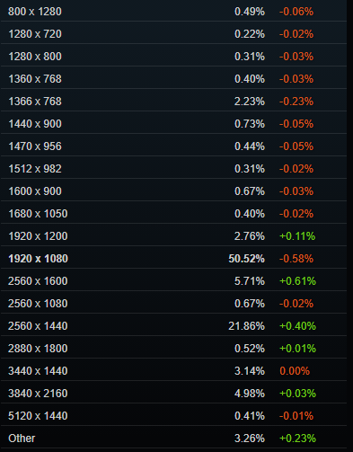

# 25/09/2026 - Tomas
## Marktext / Markdown Better Text Editor ?

In the group had small discussion about word vs markdown, and we kind agreed to try with markdown due to portability and ease of maintain. It is particularly useful for documentation, notes and works very well with git.

Few aspects such including code snippets with easy copy paste functionality from document to testing purpose, additional is using screenshots specially multiple images that word sometimes struggle to open which markdown creates reference to image and does faster then instead word embedding inside document, also markdown can be easy exported into other formats.

Visual studio code can easily edit markdown files jus need additional extension 'Markdown All in One' to edit and preview.

For local editing markdown files can be used open source app [Marktext](https://github.com/marktext/marktext)

Document to help starting with basic syntax: [Markdown Cheat Sheet](Documents/MarkText_Markdown_Cheat_Sheet.pdf)

# 29/09/2026 - Tomas
## Primary Display Resolutions Used In Steam Environment

Primary my objective was to find most popular resolution used in pc games, and the best picture are presented inside Steam Environment, because has huge user base and also does Hardware Surveys frequently. Steam Hardware Survey 2026 clearly showed which resolution are mostly used.

||
|:--:|
|*Steam Hardware Survey*|

So far most popular are 1920 x 1080 and fallowing by 2560 x 1440. That means both those screen resolutions are majority and combine them takes more than 70% of all gaming devices. As speaking about aspect ratio most popular are 16:9 and recently increasing 21:9 as more introduced into market Ultra wide monitors or devices.

View more recent data: [Steam Hardware Survey](https://store.steampowered.com/hwsurvey/Steam-Hardware-Software-Survey-Welcome-to-Steam)
